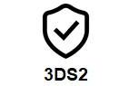

`UPC Service SDK` - це набір артефактів/класів, утилітарних функцій, інтерфейсів та констант для роботи з UPC E-Commerce API.
API працює з використанням XML та JWS форматів передачі даних.
`SDK` дозволяє абстрагуватись від необхідності слідкувати за правильним формуванням XML або JWS та їхньої верифікації.

## Безпека

UPC e-Commerce Connect використовує провідні світові технології та стандарти у галузі кібербезпеки, щоб надійно захищати дані торговців та клієнтів.

## Артефакти

| Пакет | Клас | Опис |
| --- | --- | --- |
| `@upc/sign-service` | `UpcSignService` | Реалізує підписання запитів та перевірку відповідей |
| `@upc/bin-info` | `UpcBinInfo` | Отримує інформацію про банківські BIN |
| `@upc/token-service-xml` | `UpcTokenServiceXml` | Реалізує взаємодію з Token Service API за допомогою XML |
| `@upc/token-service` | `UpcTokenService` | Реалізує взаємодію з Token Service API за допомогою JWS |
| `@upc/checkout-xml` | `UpcCheckoutXml` | Реалізує взаємодію з Checkout Service API за допомогою XML |
| `@upc/fastrefund-xml` | `UpcFastRefundXml` | Реалізує взаємодію з Refund Service API за допомогою XML |

Артефакти - це `класи` та `функції`, які реалізуються відповідні методи для взаємодії з UPC E-Commerce API.

Всі класи базуються на одному базовому класі `UpcService`, тому мають однакові параметри ініціалізації екземпляра класу.
Це спрощує розуміння та використання артефактів.

Всі артефакти надаються в скомпільованому і готовому до використання вигляді. 
Артефакти можна завантажити з [`GitHub`]() або встановити за допомогою `npm`.

## Загальні модулі

- `@upc/common` - реалізує загальні типи, константи і класи.
- `@upc/http-transport` - виконує відправку запитів і отримання відповідей.
- `@upc/xml-utils` - набір функцій для формування XML та перетворення його в JSON
